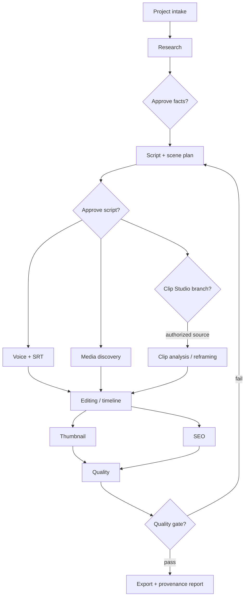

# VIDEO COMBINE AI — Agent Architecture

| Поле | Значення |
|------|----------|
| Статус | **DRAFT — очікує схвалення** |
| Версія | 0.1.0 |
| Залежить від | `01-PRD.md`, `02-TECHNICAL-ARCHITECTURE.md` |

---

## 1. Принципи

1. **Один Orchestrator, дев'ять спеціалістів.** Агенти не спілкуються вільно —
   вони обмінюються типізованими артефактами через Orchestrator.
2. **Control plane ≠ execution plane.** Orchestrator зберігає стан, а не виконує
   важку роботу сам; execution — це задачі Celery/локальний Runner.
3. **Кожен етап ідемпотентний.** Повторний запуск із тим самим `input_hash`
   не створює дублікатів.
4. **Людина — частина конвеєра.** Гейти затвердження реалізовані як
   first-class стан `AWAITING_APPROVAL`, а не як побічний UX.
5. **Жодного прихованого стану в LLM.** Усі рішення агента фіксуються у
   `AgentResult.reasoning_summary` і артефактах.

## 2. Карта етапів



Паралельні гілки (`Voice`, `Media`, `Clip`, `Thumbnail`, `SEO`) запускаються
Orchestrator-ом як окремі задачі; злиття відбувається на етапі `Editing`/`Quality`.

## 3. Контракт агента

Кожен агент реалізує єдиний інтерфейс:

```python
class BaseAgent(Protocol):
    name: str                       # "research", "script", ...
    version: str                    # версія логіки/промпту
    skill_path: str                 # відносний шлях до SKILL.md

    def input_schema(self) -> type[BaseModel]: ...
    def output_schema(self) -> type[BaseModel]: ...

    def run(self, ctx: AgentContext, payload: BaseModel) -> AgentResult: ...
    def validate(self, result: AgentResult) -> list[Issue]: ...
    def on_error(self, exc: Exception, ctx: AgentContext) -> AgentResult: ...
```

### AgentContext

| Поле | Тип | Призначення |
|------|-----|-------------|
| `project_id` | UUID | Ідентифікатор проєкту |
| `run_id` | UUID | Номер спроби конвеєра |
| `stage_id` | UUID | Номер етапу (для resume) |
| `language` | `uk \| en` | Мова контенту |
| `format` | `long \| short` | Формат ролика |
| `aspect` | `16:9 \| 9:16` | Геометрія |
| `profile` | `1080p \| 720p` | Профіль експорту |
| `artifacts` | `dict[str, ArtifactRef]` | Артефакти попередніх етапів |
| `budget` | `BudgetPolicy` | Ліміти: keyless-only / opt-in cloud / GPU |
| `deadline` | `datetime \| None` | Часовий бюджет |
| `logger` | `BoundLogger` | Структурований лог етапу |

### AgentResult

```json
{
  "agent": "script",
  "version": "0.1.0",
  "status": "ok | need_approval | failed | skipped",
  "output": { "...": "типізований payload згідно output_schema" },
  "artifacts": [{"key": "script.json", "uri": "...", "sha256": "..."}],
  "reasoning_summary": "коротке пояснення рішень без ланцюжка думок",
  "issues": [],
  "metrics": {"duration_ms": 0, "tokens": 0, "cost": 0}
}
```

### Policy помилок

| Ситуація | Дія |
|----------|-----|
| Вхід не валідний | `failed` + `ValidationIssue`, без повторів |
| Тимчасова помилка мережі | retry ×3 з експоненційною затримкою |
| Відсутній ключ/модель | `skipped` з причиною; keyless-фолбек, якщо є |
| Недостатньо прав на медіа | `failed` + `LicenseIssue`, джерело не завантажується |
| Людське втручання | `need_approval`, конвеєр ставиться на паузу |

## 4. Специфікація агентів

### 4.1 Orchestrator

- **Відповідальність**: побудова DAG етапів, диспетчеризація, гейти, resume,
  збір фінального звіту.
- **Input**: `ProjectSpec` (тема/URL/текст/файли/джерело + параметри).
- **Output**: `ProductionRun` зі статусами, артефактами, звітом якості.
- **Resume**: `resume(run_id)` завантажує checkpoint, пропускає етапи з
  `status=ok` і валідним `sha256`, повторює `failed`/`AWAITING_APPROVAL`.
- **Інваріант**: жоден етап не перезаписує чужий артефакт без нового `stage_id`.

### 4.2 Research Agent

- **Input**: `{"topic", "language", "sources_allowlist", "max_facts"}`.
- **Output**: `{"facts": [{"claim", "source_url", "source_title", "date", "confidence"}], "uncertain": [...]}`.
- **Правила**: лише перевірювані джерела; непідтверджені твердження йдуть у
  `uncertain` і **не** потрапляють у сценарій без затвердження.
- **Keyless**: SearXNG (опційний URL) + вбудовані keyless адаптери; Mistral browser
  auth — dev-only, не виробнича залежність.

### 4.3 Script Agent

- **Input**: `ResearchOutput`, `ScriptStyle`, `duration_target`, `format`.
- **Output**: `{"title", "hook", "script", "scenes": [Scene], "estimated_duration"}`.
- **Scene**: `{"index", "narration", "visual_intent", "overlay_text", "mood",
  "transition_in", "duration_seconds", "media_query"}`.
- **Гейт**: `G2` — користувач редагує сценарій/сцени перед генерацією медіа.
- **Скіл**: `outline → script → staging → storyboard` із JSON-гейтами
  (за патерном `shuohao-skills`, без копіювання коду).

### 4.4 Voice Agent

- **Input**: `ScriptOutput.scenes`, `language`, `voice_preference`.
- **Output**: `{"audio_uri", "duration", "words": [WordTiming], "srt_uri", "engine"}`.
- **Драбина `tts_save`**: `edge → piper(uk_UA) → kokoro → sapi → silence`.
- **Вимога**: word-level timing для анімованих субтитрів; SRT без змін таймкодів
  при перекладі.
- **Fallback**: silence + попередження в звіті якості — ніколи не блокує конвеєр.

### 4.5 Media Agent

- **Input**: `Scene.media_query`, `media_library`, `license_policy`.
- **Output**: `{"selections": [{"scene_index", "asset_uri", "source", "license",
  "license_url", "author", "relevance", "sha256"}], "rejected": [...]}`.
- **Правила**: тільки дозволені джерела; фіксується provenance; rejected
  містить причину (нерелевантний/недостатня якість/невизначена ліцензія).
- **Ранжування**: релевантність до `visual_intent` + технічна придатність
  (роздільна здатність, тривалість, чорні кадри).

### 4.6 Clip Agent

- **Input**: `authorized_source_uri`, `source_rights_confirmation`, `format`.
- **Output**: `{"segments": [...], "reframe": {...}, "commentary_script", "attribution"}`.
- **Заборона**: метадані не змінюються з метою приховати авторство/Content ID.
- **Обов'язково**: `attribution.title/author/url/license` у фінальному звіті.
- **Рефреймінг**: crop/pad/blur-fill для 9:16 і 16:9.

### 4.7 Thumbnail Agent

- **Input**: `ScriptOutput`, `MediaAgent select`, `product_photos`, `variants`.
- **Output**: `{"variants": [{"png_uri", "layers": [...], "aspect": "16:9|9:16"}]}`.
- **Шари**: background, product, text, badge — редагуються окремо.
- **Гейт**: вибір варіанту користувачем перед експортом.

### 4.8 SEO Agent

- **Input**: `ScriptOutput`, `ThumbnailOutput`, `language`, `format`.
- **Output**: `{"title", "description", "tags", "hashtags", "keywords",
  "pinned_comment", "shorts_variant": {...}}`.
- **Правила**: факти з ResearchOutput; без clickbait, що суперечить сценарію.

### 4.9 Editing Agent

- **Input**: сценарій, таймінги голосу, медіа, переходи, музика, субтитри.
- **Output**: `{"timeline_uri", "render_uri", "render_profile", "duration"}`.
- **Вимога**: editable project file + структурований таймлайн (не лише готовий MP4).

### 4.10 Quality Agent

- **Input**: всі артефакти + таймлайн.
- **Output**: `{"passed", "checks": [{"name", "status", "detail"}], "blocking": [...]}`.
- **Перевірки**: чорні кадри, LUFS, ASR-звірка субтитрів, синхронізація,
  наявність атрибуції, відповідність профілю (1080p/720p, 16:9/9:16),
  відсутність секретів у метаданих.
- **Дія при провалі**: повернення до Script/Media, не «тихий» реліз.

## 5. Стан у репозиторії (факти)

Наразі «агенти» — це markdown-інструкції (`skills/pipelines/*/<stage>-director.md`,
`skills/meta/*`, `.agents/skills/**/SKILL.md`), а не Python-рантайм. Використовується:
- `lib/checkpoint.py::get_next_stage()` — відновлення за етапом (база для resume),
- `tools/tool_registry.py` — реєстр інструментів із `fallback_tools`,
  `idempotency_key_fields`, `retry_policy`,
- `lib/events.py` — події у `events.jsonl`.

Тому New `studio/agents/` не замінює ці механізми, а **обгортає** їх: агент
викликає вже існуючий tools/checkpoint, додаючи контракт, версію, гейт і логи.

## 6. Реєстр агентів (єдине джерело істини)

`studio/agents/registry.py` містить `{name: (class, version, skill_path, dependencies)}`.
Orchestrator читає реєстр і відмовляє у запуску невідомого агента. Версія агента
зберігається в checkpoint — це унеможливлює «тихий» регрес після оновлення коду.

## 7. Тестування агентів

Кожен агент має:
- unit-тест контракту (input/output schema, валідація),
- тест помилки (відсутній ключ/мережа/ліцензія),
- тест ідемпотентності (той самий `input_hash` → той самий artifact),
- smoke-тест у складі Orchestrator-а з моками.

---

*Наступний документ: `05-SKILLS-ARCHITECTURE.md`.*
